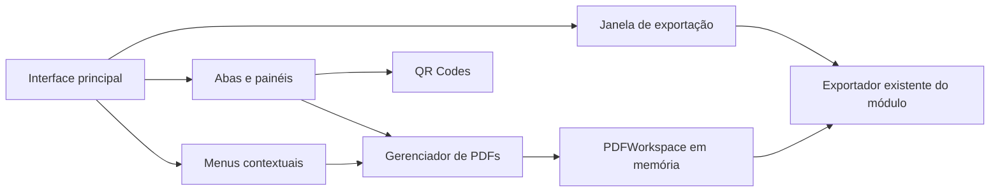

# Interface principal e ciclo de vida das ferramentas

Implementação de 30/10/2026. Executar como antes: `node app.js`, acessando `http://localhost:3000`.

## Organização

- `public/index.html` monta `#app-shell`, sem cabeçalho grande ou sidebar global.
- `public/js/main.js` registra os dois módulos ativos, PDFs e QR Codes, e injeta a janela compartilhada de exportação. Novas ferramentas reais entram nesse registro, sem cartões fictícios.
- `app/shell.js` apresenta Início, cartões, abas e painéis de trabalho.
- `app/tabs.js` é dono das instâncias e serializa abertura, alternância e fechamento.
- `app/menus.js` apresenta os comandos que a ferramenta ativa fornece.
- `app/export-dialog.js` fornece a janela de confirmação e o cancelamento; não processa bytes PDF.
- Adesivos foi retirado da aplicação principal; adaptador, configurador e modelos estão preservados, sem importação/inicialização pela UI. Inventário e compatibilidade em [LEGADO_ADESIVOS.md](LEGADO_ADESIVOS.md). O PDF permanece no seu workspace privado.

## Contrato e preservação das abas

Cada registro possui `id`, `titulo`, `descricao` e `montar(painel)`. A montagem devolve um controlador, opcionalmente por Promise:

- `suspender()`: chamado e aguardado **antes de ocultar**. Para filas/renderizações sem descartar documento, seleções ou configurações.
- `retomar()`: chamado **depois de mostrar**. Recalcula medidas visuais e retoma apenas o trabalho necessário.
- `podeAlternar()`: pode impedir transições durante um modal, evitando janelas escondidas e confirmações concorrentes.
- `confirmarFechamento()`: permite ou recusa fechar. Somente fechar consulta esse método; alternar e visitar Início não consultam.
- `destruir()`: encerra os recursos ao fechar, depois da confirmação. Deve ser idempotente.
- `menus()`: fornece grupos e comandos reais da ferramenta.

Início é a primeira aba e não fecha. O mapa contém no máximo uma instância de cada ferramenta. Abrir um cartão já montado ativa a mesma instância. Os hosts permanecem no DOM, com `hidden` quando inativos; alternar não substitui seu HTML. Ao fechar uma aba de fundo, o gerenciador primeiro a torna visível para que a confirmação possa ser lida. Cancelar mantém essa aba e o trabalho. Confirmar desmonta e remove o host; a aba anterior na ordem, ou Início, é ativada.

O PDF mantém a mesma instância de `PDFWorkspace`, documento PDF.js, ordem/rotações, seleção por IDs, página solicitada/exibida, painel contextual, campos e prévia temporária de redimensionamento. As coordenadas de rolagem são guardadas antes de ocultar e restauradas ao voltar; limites físicos da janela ainda podem restringi-las. Zoom manual conserva escala; os encaixes são recalculados para a área visível atual. A confirmação de fechamento não cancela a prévia antes da resposta: recusar não apaga a configuração.

Antes da troca, uma operação de edição/serialização já iniciada termina com o módulo ainda visível. RenderTasks principais são canceladas; a fila de miniaturas pausa, invalida a geração e retém seleção/cache limitado. Enquanto oculta, não cria novas renderizações. Retomar reativa a fila pendente sem reconstruir a fonte PDF.js. O parsing interno já solicitado ao PDF.js pode terminar mesmo após cancelar a espera; não se destrói o documento para tentar interrompê-lo, pois isso perderia o estado.

`beforeunload` continua consultando o workspace mesmo quando a aba PDF está oculta. Importar outro arquivo mantém a confirmação de substituição. Fechar a aba libera os listeners, observadores, canvases e tarefas pelos donos existentes. Reabrir uma aba fechada inicia um novo documento vazio.

## Menus e área dedicada

PDFs fornece Arquivo, Editar e Exibir. Os comandos encaminham aos controles reais já existentes: importar, adicionar pela união, exportar, Informações, organizar/duplicar/excluir, girar, mover e encaixar/zoom/painel. A habilitação é consultada ao abrir e novamente antes de executar. Apenas um menu fica aberto; setas e Escape permitem navegar/fechar pelo teclado. As ferramentas laterais e os controles frequentes permanecem disponíveis.

QR Codes recebe apenas comandos aplicáveis, como fechar a aba e visitar Início. Não recebe um Editar vazio nem exportações fictícias. Adesivos não tem cartão, aba ou menu registrado. Um comando antigo com ID indisponível é informado e recusado sem desmontar a ferramenta atual ou gerar rejeição não tratada no clique.

O shell ocupa a janela; cada painel de módulo rola internamente. PDFs conserva miniaturas/centro/ferramentas, suas divisórias, preferências e virtualização. O nome, estado técnico e indicador de alterações continuam no topo do próprio documento. `sidebar.js` permanece no repositório como legado, sem ser montado pela aplicação.

## Exportação confirmada

Uma instância de `JanelaExportacao` pertence à aplicação. PDF usa `abrir(dados, exportar, dono)`. Montagens isoladas de `renderPDFs(container)` usam a mesma classe localmente, inclusive nos testes. Não há uma segunda implementação de processamento.

A janela mostra nome editável, formato **PDF** realmente suportado, modalidade atual, páginas, grupos de dimensões, estado de alterações e avisos relevantes. Documentos sem edição também podem ser exportados. Uma cópia preparada no fluxo de assinaturas mantém `_IMPRESSAO`, inclusive ao renomear. Nenhum PNG/JPEG, conversão ou controle de DPI novo foi oferecido. O preparo seletivo/integral e sua resolução continuam no fluxo Resolver; a janela apenas exporta a versão já aplicada.

Abrir ou cancelar a janela não altera o workspace nem inicia download. Exportar valida o nome e chama a rotina existente em `pdfs.js`: captura a versão, obtém bytes pelo workspace, cria o download e registra **aquela** versão. Os motores de resize, assinaturas, compatibilidade PowerPoint e escrita do workspace não foram substituídos.

Cancelar enquanto os bytes são gerados aborta a solicitação antes de disparar o download; a serialização pode precisar terminar, mas não quita pendências. Falhas ficam na janela, que permite corrigir/repetir, e não marcam a versão como exportada. Depois que o navegador aceita o download, JavaScript não comprova que o usuário concluiu a gravação em disco: a marcação conserva esse limite do fluxo anterior. A extração legada continua baixando diretamente e não quita a exportação do documento completo.

## Limites e futuras distribuições

- Documentos/abas **não** são recuperados após recarregar ou reiniciar. Somente preferências/biblioteca que já eram persistentes continuam em localStorage.
- A implementação usa HTML/CSS/ES Modules e mantém o servidor Node atual. Há também um wrapper Electron experimental, com a mesma interface na origem fixa `app://4printshops`, sem servidor/porta internos. Não há autenticação, licenciamento ou backend online novo.
- `app/save-file.js` seleciona o serviço nativo restrito no Desktop e o download existente no navegador. O workspace só é quitado após a gravação nativa concluída. Processo principal, protocolo, IPC, instalador e atualizações opcionais estão separados em `desktop/`; detalhes em [DISTRIBUICAO_DESKTOP.md](DISTRIBUICAO_DESKTOP.md). O shell continua funcionando sem APIs Desktop; o comando de atualizações aparece somente quando a ponte está disponível.
- Novos formatos/módulos devem fornecer exportadores reais antes de ampliar a janela. Hoje sua modalidade implementada é PDF.
- As limitações de assinatura/Acrobat/RIP, fidelidade de casos complexos e recursos bloqueados continuam registradas em `ASSINATURAS_E_COPIAS_IMPRESSAO.md` e `ESTADO_PROJETO.md`.

## Verificação e aceitação

Os testes `app-tabs.test.mjs` e `app-export-dialog.test.mjs` verificam o contrato; os testes PDF existentes permanecem. `node tests/pdf-browser-smoke.mjs` executa também `helpers/app-tabs-browser.mjs`. Para conferir só a estrutura no PowerShell: `$env:APP_TESTE_ABAS_APENAS='1'; node tests/pdf-browser-smoke.mjs`. Limpar essa variável para a regressão completa.

1. Abrir cada cartão; alternar entre abas e Início; tentar abrir a ferramenta novamente e conferir que não duplica.
2. No PDF, importar, selecionar várias páginas, girar/reorganizar e ajustar zoom/scroll/painéis. Alternar várias vezes e comparar o estado. Repetir com 100/350 páginas e janela pequena/ampla.
3. Preparar uma prévia de redimensionamento, sem aplicar; trocar de aba e voltar. Conferir formato/campos/prévia. Fechar com alterações: cancelar deve preservar tudo; confirmar deve encerrar. Importar outro documento e atualizar/fechar o navegador devem continuar protegidos.
4. Usar Arquivo/Editar/Exibir por mouse e teclado; conferir que repetem os comandos reais e os estados habilitados.
5. Abrir Exportar e cancelar; conferir que nada baixou e as pendências permanecem. Exportar PDF sem edições, documento editado e cópia `_IMPRESSAO`; conferir nomes, páginas/rotações e reabrir. Comparar cópia de impressão com leitor confiável/RIP.
6. Conferir somente cartões PDFs/QR Codes e ausência de Adesivos em abas/menus. QR Codes continua sendo o módulo inicial em desenvolvimento; fechar/reabrir também pelo menu Arquivo. Comandos antigos de Adesivos não devem abrir painéis ou carregar o configurador/API, nem alterar o PDF ou sua proteção. As rotas e o legado CorelDRAW foram preservados separadamente, conforme `LEGADO_ADESIVOS.md`.
